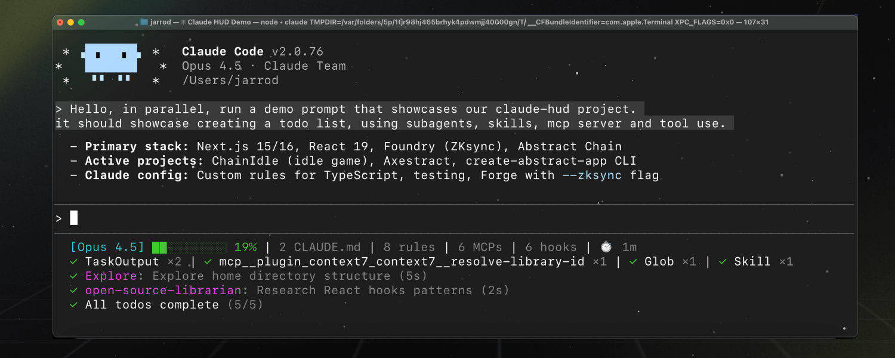

# Claude HUD

A Claude Code plugin that shows what's happening: context usage, rate limits, active tools, running agents, and todo progress, always visible below your input.

[](LICENSE)
[](https://github.com/jarrodwatts/claude-hud/stargazers)



> 🌐 English | [中文文档](README.zh.md)

> 📌 本仓库是上游 [jarrodwatts/claude-hud](https://github.com/jarrodwatts/claude-hud) 的 vendored 副本（当前 **0.13.0**，MIT，上游通过 `upstream` remote 以 merge 方式同步）加上 `custom/` 里我自己的 statusLine 定制脚本。仓库布局、定制怎么装、怎么跟上游同步，见文末「[我对 claude-hud 的定制](#我对-claude-hud-的定制custom)」。

## Install

Inside Claude Code, run:

```
/plugin marketplace add jarrodwatts/claude-hud
/plugin install claude-hud
/reload-plugins
/claude-hud:setup
```

`/claude-hud:setup` points your status line at the HUD. Claude Code reloads settings on its own, so the HUD appears right away. To customize it, ask Claude or run `/claude-hud:configure`.

<details>
<summary><strong>Prefer the terminal?</strong></summary>

```bash
claude plugin marketplace add jarrodwatts/claude-hud
claude plugin install claude-hud@claude-hud
```

Then run `/reload-plugins` and `/claude-hud:setup` inside a session.

</details>

<details>
<summary><strong>Windows: setup says no JavaScript runtime was found</strong></summary>

Install Node.js LTS (`winget install OpenJS.NodeJS.LTS`), restart your shell, and run `/claude-hud:setup` again.

</details>

**Updates:** Claude Code doesn't auto-update third-party plugins by default. To turn it on, run `/plugin`, open **Marketplaces**, select **claude-hud**, and choose **Enable auto-update**. If that option isn't there, or updates don't arrive, update by hand from the terminal:

```bash
claude plugin marketplace update claude-hud
claude plugin update claude-hud@claude-hud
```

Then run `/reload-plugins` in any open session. You don't need to run setup again.

## What You See

The default is two lines:

```
[Opus] │ my-project git:(main*)
Context █████░░░░░ 45% │ Usage ██░░░░░░░░ 25% (resets in 1h 30m)
```

- **Line 1**: model, a provider label when one is detected (`Bedrock`, `Vertex`, `MiniMax`), project path, and git branch.
- **Line 2**: context used (green, then yellow, then red as it fills) and your subscriber rate limits.

Optional lines, which you turn on with `/claude-hud:configure`:

```
◐ Edit: auth.ts | ✓ Read ×3 | ✓ Grep ×2        ← tools
◐ explore [haiku]: Finding auth code (2m 15s)    ← agents
▸ Fix authentication bug (2/5)                   ← todos
```

## How It Works

Claude HUD is a [status line](https://code.claude.com/docs/en/statusline) command. Claude Code runs it with session data on stdin (model, context window, cost, rate limits, prompt cache) and shows what it prints. Some optional elements, such as the tools, agents, and todos lines, also read the session transcript. It needs no separate window or tmux and works in any terminal.

## Configuration

```
/claude-hud:configure
```

The guided flow covers layout, activity lines, session info, usage, git, language, and a custom line. It previews the changes before saving and keeps every setting it doesn't ask about.

Everything else lives in `~/.claude/plugins/claude-hud/config.json` (or under `$CLAUDE_CONFIG_DIR`). Invalid values fall back to their defaults.

If several `CLAUDE_CONFIG_DIR`s share one `plugins/` directory, put per-directory settings in `$CLAUDE_CONFIG_DIR/claude-hud.json`. It uses the same shape, only needs the keys it changes, and is layered on top of the shared config:

```json
{ "display": { "customLine": "Work Team" } }
```

Labels are available in English (the default), Simplified Chinese (`zh-Hans`, alias `zh`), and Traditional Chinese (`zh-Hant`, alias `zh-TW`).

### Options

| Option | Type | Default | Description |
|--------|------|---------|-------------|
| `language` | `en` \| `zh` \| `zh-Hans` \| `zh-Hant` \| `zh-TW` | `en` | HUD label language. Use `zh` or `zh-Hans` for Simplified Chinese and `zh-Hant` or `zh-TW` for Traditional Chinese. |
| `lineLayout` | string | `expanded` | Layout: `expanded` (multi-line) or `compact` (single line) |
| `showSeparators` | boolean | false | In `compact` layout, draw a rule between the session line and the activity lines |
| `pathLevels` | 1-3 \| `full` | 1 | Directory levels to show in project path, or `full` to show the entire absolute path |
| `maxWidth` | number \| `null` | `null` | Optional fallback width used only when terminal width detection fails completely |
| `forceMaxWidth` | boolean | false | Always use `maxWidth` when it is set, even if terminal width detection returns a smaller value |
| `elementOrder` | string[] | `["project","addedDirs","context","usage","promptCache","cacheHitRate","memory","environment","tools","skills","mcp","agents","todos","sessionTime"]` | Expanded-mode element order. Omit entries to hide them in expanded mode. Existing configs keep their explicit order until updated. `sessionTokens` isn't in the default order: add it to place the `display.showSessionTokens` summary like any other element, for example in a `display.mergeGroups` group with `project`. Left out, it stays on its own last line. `cost` works the same way: left out, the cost segment stays on the first line (where `projectLineOrder` can move it); added, it becomes its own element, for example `"context","usage","cost"` in `elementOrder` with `["context","usage","cost"]` in `display.mergeGroups` puts it beside context and usage. |
| `projectLineOrder` | string[] | `[]` | Optional leading order of segments *within* the first line, in both layouts. Visibility stays with the `display.show*` flags, and omitted segments retain their existing renderer order. `model` covers provider + model + effort (plus the context bar in compact mode); `project` covers path + added dirs + git as one segment. Example: `["project","model"]` puts the project/git block before the model badge. |
| `display.mergeGroups` | string[][] | `[["context","usage"]]` | Expanded-mode groups that should share a line when adjacent. Set `[]` to disable merged lines. |
| `display.rightAlign` | string[] | `[]` | Starts a right-aligned suffix at the first listed element in a merged row, preserving `elementOrder` and padding the gap with spaces. Requires the anchor to be in a `display.mergeGroups` group that actually renders on one line. Ignored when the terminal width is unknown, the anchor is first, or there is no room for padding. Example: `["context"]` with a `["project","context","usage"]` group keeps project/git left and pins context + usage right. |
| `gitStatus.enabled` | boolean | true | Show git branch in HUD |
| `gitStatus.showDirty` | boolean | true | Show `*` for uncommitted changes |
| `gitStatus.showAheadBehind` | boolean | false | Show `↑N ↓N` for ahead/behind remote |
| `gitStatus.pushWarningThreshold` | number | 0 | Color the ahead count with the warning color at or above this unpushed-commit count (`0` disables it) |
| `gitStatus.pushCriticalThreshold` | number | 0 | Color the ahead count with the critical color at or above this unpushed-commit count (`0` disables it) |
| `gitStatus.showFileStats` | boolean | false | Show file change counts `!M +A ✘D ?U` |
| `gitStatus.showWorktree` | boolean | false | In a linked git worktree, show its name after the branch, e.g. `git:(feat/x) ⎇ feat-x` |
| `gitStatus.branchOverflow` | `truncate` \| `wrap` | `truncate` | Keep current truncation behavior or let the git block wrap onto its own line boundary when possible |
| `jjStatus.enabled` | boolean | false | Opt in to jj (Jujutsu) status. When enabled and a real `.jj` directory is found, jj is used instead of git for that repo — never both |
| `jjStatus.showDirty` | boolean | true | Show `*` when the working-copy commit differs from its parent |
| `jjStatus.showConflicts` | boolean | true | Show a `!conflict` marker when the working-copy commit has an unresolved conflict |
| `display.showModel` | boolean | true | Show model name `[Opus]` |
| `display.showProject` | boolean | true | Show the project path |
| `display.modelSource` | `stdin` \| `auto` \| `transcript` | `stdin` | Controls which source the model name comes from. `stdin` preserves the default behavior and always uses what Claude Code reports. `auto` opts into proxy redirect detection by using transcript models only for non-Claude models. `transcript` always uses the model from the API response. Transcript model values are terminal-sanitized and capped at 80 characters |
| `display.modelFormat` | `full` \| `compact` \| `short` | `full` | `compact` drops a context-window suffix such as `(1M context)`; `short` also drops a leading `Claude ` |
| `display.modelOverride` | string | `""` | Show this text instead of the model name (80 characters max) |
| `display.showProvider` | boolean | false | Show the provider label *before* the model name, e.g. `[Bedrock \| Opus 4.6]`. Useful when a custom proxy serves identically-named models from different providers. When off, an auto-detected provider still trails the model as before |
| `display.providerName` | string | `""` | Explicit provider label used with `display.showProvider`, e.g. for a custom proxy that can't be auto-detected. Falls back to the auto-detected provider (Bedrock/Vertex/MiniMax/Enterprise) when empty; capped at 40 chars |
| `display.showAddedDirs` | boolean | true | Show extra workspace directories from `/add-dir` (e.g. `+sparkle +lib-foo`); empty array renders nothing. In both layouts at most 5 dirs render (overflow shown as `+N more`) and basenames are truncated to 24 chars with `…` |
| `display.addedDirsLayout` | `inline` \| `line` | `inline` | `inline` puts dirs next to the project name with a `+name` prefix per dir; `line` renders them on a separate `Added dirs: name1, name2` line (no `+` prefix, comma-separated) |
| `display.showContextBar` | boolean | true | Show visual context bar `████░░░░░░` |
| `display.contextValue` | `percent` \| `tokens` \| `remaining` \| `both` | `percent` | Context display format (`45%`, `45k/200k`, `55%` remaining, or `45% (45k/200k)`) |
| `display.autoCompactWindow` | number \| `null` | `null` | When set to a positive number such as `200000`, compute the context percentage against this auto-compact window instead of the full model context window, matching the `/context` figure. Leave unset or `null` to preserve default full-window behavior. |
| `display.showConfigCounts` | boolean | false | Show CLAUDE.md, rules, MCPs, hooks counts |
| `display.environmentThreshold` | number | 0 | Hide the config counts until their total reaches this number (0 = always show) |
| `display.showCost` | boolean | false | Show the session cost Claude Code reports (`cost.total_cost_usd`) |
| `display.showRoutedCost` | boolean | false | Also show cost for Bedrock and Vertex sessions, which `showCost` hides because they bill through the cloud provider. Requires `showCost` |
| `display.showDailyCost` | boolean | false | Show today's cumulative spend across sessions as `Today $12.34`, accumulated from the native `cost.total_cost_usd` into a small per-day ledger in the plugin data directory. Resets at local midnight. Independent of `showCost` |
| `display.showWeeklyCost` | boolean | false | Show spend since the weekly quota window opened as `Week $123.45`, from the same ledger as `showDailyCost`. Subscribers only: needs the 7-day usage window |
| `display.showOutputStyle` | boolean | false | Show the current output style as `style: <name>` |
| `display.showDuration` | boolean | false | Show how long the session has been running, e.g. `⏱️ 5m` |
| `display.showSpeed` | boolean | false | Show the latest response's output speed `out: 42.1 tok/s` |
| `display.showUsage` | boolean | true | Show Claude subscriber usage limits when available |
| `display.usageValue` | `percent` \| `remaining` | `percent` | Usage display format (`25%` used, or `75%` remaining) |
| `display.usageBarEnabled` | boolean | true | Display usage as visual bar instead of text |
| `display.usageCompact` | boolean | false | Display usage in a shorter text form such as `5h: 25% (1h 30m)`; takes precedence over `display.usageBarEnabled` |
| `display.showResetLabel` | boolean | true | Show the `resets in` prefix before usage countdowns |
| `display.showModelScopedUsage` | boolean | true | Show the per-model weekly windows (`model_scoped`, e.g. Fable), whether they arrive on stdin or from the external usage snapshot. Set to `false` to render the usage line as if the payload carried none of them |
| `display.usagePace` | boolean | false | Colour usage windows amber or red, marked `▲`, when they are on track to run out before they reset |
| `display.timeFormat` | `relative` \| `absolute` \| `both` \| `elapsed` \| `elapsedAndAbsolute` | `relative` | How usage-window time is shown: countdown only (`resets in 2h 30m`), wall-clock reset (`resets at 14:30`), both, elapsed window percentage (`53% elapsed`), or elapsed plus wall-clock reset |
| `display.hourCycle` | `auto` \| `h11` \| `h12` \| `h23` \| `h24` | `auto` | Hour cycle for wall-clock reset times (`absolute`/`both`/`elapsedAndAbsolute` modes). `auto` defers to the system locale; `h23` forces 24-hour time (`14:30`) regardless of locale |
| `display.showClockSeconds` | boolean | false | Show seconds in wall-clock reset times, e.g. `at 14:30:07` |
| `display.usageThreshold` | 0-100 | 0 | Hide the usage display until either window reaches this percentage (0 = always show) |
| `display.sevenDayThreshold` | 0-100 | 80 | Show 7-day usage when >= threshold (0 = always) |
| `display.externalUsagePath` | string | `""` | Optional absolute path to a local usage snapshot file. A leading `~` and `${VAR}` are expanded. Relative paths are ignored. When stdin `rate_limits` are present, `balance_label` is appended and `model_scoped` windows fill in when stdin lacks them; when stdin windows are missing, valid usage windows can be used as a fallback |
| `display.externalUsageWritePath` | string | `""` | Optional absolute `.json` path in an existing directory. A leading `~` and `${VAR}` are expanded. When stdin `rate_limits` exists, ClaudeHUD writes a private snapshot for other local tools. Relative paths, non-json files, and missing parent directories are ignored |
| `display.externalUsageFreshnessMs` | number | `300000` | Maximum allowed age for the external usage snapshot before it is ignored |
| `display.showTokenBreakdown` | boolean | true | Show token details at high context (85%+) |
| `display.contextWarningThreshold` | 0-100 | 70 | Context percentage at which the context bar turns the warning colour |
| `display.contextCriticalThreshold` | 0-100 | 85 | Context percentage at which the context bar turns the critical colour and shows the token breakdown |
| `display.showTools` | boolean | false | Show tools activity line |
| `display.showSkills` | boolean | false | Show active Skills detected from `Skill` tool invocations |
| `display.showMcp` | boolean | false | Show active MCP servers detected from `mcp__server__tool` invocations |
| `display.toolNameMaxLength` | number | `0` | Maximum displayed tool-name length. `0` keeps full names; MCP names may shorten to their final segment when truncating |
| `display.toolsMaxVisible` | number | `4` | Maximum completed tools shown on the tools line. `0` means unlimited |
| `display.skillsMaxVisible` | number | `4` | Maximum skill names shown on the skills line before `+N more`. `0` means unlimited |
| `display.showAgents` | boolean | false | Show agents activity line |
| `display.showTodos` | boolean | false | Show todos progress line |
| `display.showSessionName` | boolean | false | Show the session name: the `/rename` name, or the title Claude Code generated |
| `display.showSessionTokens` | boolean | false | Show the session's cumulative token totals, e.g. `Tokens 262k (in: 6k, out: 2k, cache: 254k)` |
| `display.showAuth` | boolean | false | Show the auth method (subscription plan) of the current login as its own segment at the end of the first line, e.g. `Claude Max 20x`. Derived from the `oauthAccount` block in `~/.claude.json` (or `$CLAUDE_CONFIG_DIR/.claude.json` when the config directory is overridden); shows `API Key` when there is no OAuth login but `ANTHROPIC_API_KEY` is set |
| `display.showAuthUser` | boolean | false | Show the logged-in account (email local part, falling back to profile display name) next to the auth method |
| `display.authUserLength` | number | `8` | Maximum characters of the account name to display before truncating with `…`. `0` shows the full name |
| `display.showAdvisor` | boolean | false | Inline the model configured via Claude Code's `/advisor` on the project line, e.g. `Advisor: Opus 4.7`. Read from the `advisorModel` field that Claude Code stamps on each assistant transcript record; sanitised and capped at 64 chars before rendering |
| `display.advisorOverride` | string | `""` | Optional manual override for the displayed advisor label. When non-empty, replaces transcript-driven detection. Also sanitised and capped at 64 chars |
| `display.showSessionStartDate` | boolean | false | Show the transcript session start timestamp |
| `display.showLastResponseAt` | boolean | false | Show how long ago the last assistant response was written |
| `display.showCompactions` | boolean | false | Show how many context compactions (manual `/compact` or auto) have occurred this session, counted from transcript `compact_boundary` entries, e.g. `Compactions: 2`. Hidden until the first compaction |
| `display.showEffortLevel` | boolean | false | Show the current reasoning effort in the model badge. Ultracode renders as `ultracode(xhigh)`, detected from the session transcript so it tracks `/effort` changes made at runtime |
| `display.effortFormat` | `full` \| `symbol` \| `text` | `full` | How the effort renders when `display.showEffortLevel` is on: symbol and level text (`◑ high`), symbol only (`◑`), or level text only (`high`). Ultracode keeps the full `◕ ultracode(xhigh)` form under `symbol` so the marker is not lost, and levels without a known symbol fall back to the level text |
| `display.showAgentEffort` | boolean | false | With `display.showAgents`, show each subagent's reasoning effort next to its model, e.g. `◐ code-reviewer [haiku-4.5 ◔ medium]`, in `display.effortFormat`. Read from the subagent's own transcript, so it appears once Claude Code has recorded the agent's id (at launch for background agents, at the end otherwise) and its first reply |
| `display.showClaudeCodeVersion` | boolean | false | Show the running Claude Code version, e.g. `CC v2.1.81` |
| `display.showMemoryUsage` | boolean | false | Show an approximate system RAM usage line in expanded layout |
| `display.showPromptCache` | boolean | false | Show when the main conversation's prompt cache expires |
| `display.showCacheHitRate` | boolean | false | Show the session's prompt-cache hit rate as `Cache hit X%` |
| `display.customLine` | string | `""` | Custom text shown on the first line (80 characters max) |
| `display.customLinePosition` | `first` \| `last` | `last` | Put the custom text at the start or the end of the first line |
| `colors.context` | color value | `green` | Base color for the context bar and context percentage |
| `colors.usage` | color value | `brightBlue` | Base color for usage bars and percentages below warning thresholds |
| `colors.warning` | color value | `yellow` | Warning color for context thresholds and usage warning text |
| `colors.usageWarning` | color value | `brightMagenta` | Warning color for usage bars and percentages near their threshold |
| `colors.critical` | color value | `red` | Critical color for limit-reached states and critical thresholds |
| `colors.model` | color value | `cyan` | Color for the model badge such as `[Opus]` |
| `colors.project` | color value | `yellow` | Color for the project path |
| `colors.git` | color value | `magenta` | Color for git wrapper text such as `git:(` and `)` |
| `colors.gitBranch` | color value | `cyan` | Color for the git branch and branch status text |
| `colors.label` | color value | `dim` | Color for labels and secondary metadata such as `Context`, `Usage`, counts, and progress text |
| `colors.custom` | color value | `208` | Color for the optional custom line |
| `colors.barFilled` | string | `█` | Character used for the filled portion of progress bars |
| `colors.barEmpty` | string | `░` | Character used for the empty portion of progress bars |

Colors accept a name (`dim`, `red`, `green`, `yellow`, `magenta`, `cyan`, `brightBlue`, `brightMagenta`), a 256-color number (`0-255`), or hex (`#rrggbb`). `colors.barFilled` and `colors.barEmpty` take a single visible character; wide characters such as emoji may affect bar alignment in some terminals.

### Usage Limits

Usage shows whenever Claude Code sends subscriber `rate_limits`, which is after the first response of a session. API-key, Bedrock, and Vertex sessions have no subscriber limits, so it stays hidden. The 7-day window appears once it passes `display.sevenDayThreshold`:

```
Context █████░░░░░ 45% │ Usage ██░░░░░░░░ 25% (resets in 1h 30m) | Weekly █████████░ 85% (resets in 1d)
```

With `display.usagePace`, a window you're using faster than it refills turns amber (on track to end at 90% or more) or red (on track to run out first) and gets a `▲`. Windows under 10% used stay neutral.

**External snapshot.** `display.externalUsagePath` reads a local JSON file. Its windows fill in when stdin has none, and its `balance_label` or `model_scoped` windows (for example a per-model weekly quota) add to stdin's. The file must be absolute and fresher than `display.externalUsageFreshnessMs`:

```json
{
  "updated_at": "2026-04-20T12:00:00.000Z",
  "five_hour": { "used_percentage": 42, "resets_at": "2026-04-20T15:00:00.000Z" },
  "seven_day": { "used_percentage": 84, "resets_at": "2026-04-27T12:00:00.000Z" },
  "balance_label": "$12.50",
  "model_scoped": [{ "display_name": "Fable", "utilization": 89, "resets_at": "2026-04-27T11:00:00Z" }]
}
```

`display.externalUsageWritePath` does the reverse: it writes stdin's rate limits to a private `.json` file in an existing directory for other tools to read.

### Cost

`display.showCost` shows Claude Code's own session cost, computed at list price or from your `modelPricing` table. Bedrock and Vertex bill through the cloud provider, so their cost is hidden unless `display.showRoutedCost` is also set.

`display.showDailyCost` adds today's spend across sessions (`Today $12.34`). It is kept in a small ledger in the plugin data directory, resets at local midnight, and counts a session from the first render that sees it. `display.showWeeklyCost` uses the same ledger from the start of the 7-day quota window, so it needs a subscriber session.

### Prompt Cache

`display.showPromptCache` shows when the main conversation's prompt cache goes cold, such as `Cache ⏱ until 14:30`, or `expired`. It shows a clock time rather than a countdown because the status line doesn't repaint between turns, which is exactly when the cache drains; a clock time stays correct however old the render is. `display.showCacheHitRate` shows the share of input tokens read from the cache.

### Jujutsu (jj)

Set `jjStatus.enabled` to `true` to show jj status, such as `jj:(mybookmark*)` or `jj:(wrulwzyw !conflict)`, instead of git in a directory with a `.jj` repository. The HUD runs jj read-only without snapshotting the working copy, so the dirty marker reflects jj's last snapshot. Ahead/behind and file stats are git-only.

### Example

```json
{
  "lineLayout": "expanded",
  "pathLevels": 2,
  "gitStatus": { "showAheadBehind": true, "showFileStats": true },
  "display": {
    "showTools": true,
    "showAgents": true,
    "showTodos": true,
    "showDuration": true,
    "showCost": true
  },
  "colors": { "context": "cyan", "custom": "#FF6600" }
}
```

### Auto-Refresh

Claude Code re-runs the status line after each message, `/compact`, a permission or vim mode change, a rate-limit reset, and a prompt-cache expiry. To keep countdowns and durations ticking while a session is idle, add `refreshInterval` (seconds) to the `statusLine` entry in `~/.claude/settings.json`.

### Turning It Off for a Session

```bash
CLAUDE_HUD_DISABLE=1 claude
```

Any value other than `0`, `false`, `off`, or `no` blanks the HUD for that session without touching `settings.json`.

## Security

Claude HUD is local-only. It makes no network requests, never reads credentials, and calls no undocumented APIs. It reads Claude Code's stdin, the session transcript, Claude configuration files, and git or jj metadata for the current directory. Its only writes are small state files (output speed and the cost ledger) under `~/.claude/plugins/claude-hud`, with private permissions.

`--extra-cmd` runs a shell command on every refresh and puts its output on the first line. It is ignored unless `CLAUDE_HUD_ALLOW_EXTRA_CMD=1` is set in the HUD's environment. Treat it as arbitrary code execution and never use a command from an untrusted source.

## Troubleshooting

**The HUD doesn't appear.** Send a message, because the status line renders after an interaction. Check that `CLAUDE_HUD_DISABLE` isn't set in your shell. Run `/claude-hud:setup` again if your Node or Bun path changed, for example after an nvm or mise upgrade.

**Config isn't applying.** Check the JSON for syntax errors: an invalid file falls back to the defaults. Check that values are in range; the options table lists them.

**Usage is missing.** Usage needs a Claude subscriber login and appears after the first response. Check `display.showUsage`.

**Git or jj status is missing.** Check that you're inside a repository and that `gitStatus.enabled` (or `jjStatus.enabled` with `jj` on `PATH`) is on.

**An activity line is missing.** Tools, agents, todos, skills, and MCP lines are off by default and only show when there's activity.

## Requirements

- Claude Code v2.1.260 or later
- macOS or Linux: Node.js 18+ or Bun
- Windows: Node.js 18+

## Development

```bash
git clone https://github.com/jarrodwatts/claude-hud
cd claude-hud
npm ci && npm test
```

See [CONTRIBUTING.md](CONTRIBUTING.md).

## License

MIT. See [LICENSE](LICENSE).

## Star History

[](https://star-history.com/#jarrodwatts/claude-hud&Date)

---

## 我对 claude-hud 的定制（custom/）

本目录是 [jarrodwatts/claude-hud](https://github.com/jarrodwatts/claude-hud) 之外的个人定制。
**插件源码一行未改**，全部定制放在插件目录之外，通过两个口子实现：

1. 插件原生配置 `config.json`（0.8.0 起有外部快照接口 `display.externalUsagePath`）。
2. `~/.claude/settings.json` 里的 `statusLine.command`：不再直接跑插件，而是跑自己的 `hud-render.mjs`。它在**同一个 node 进程里** import 插件 `dist/` 里的各个模块，由 `hud-pipeline.mjs` 复刻插件 `main()` 的流程并把 git 状态、配置、stdin 三个依赖换成自己的实现（插件 0.10.0 起 `main()` 不再接受注入），再把插件输出截下来追加两行。

这样 `claude plugin update claude-hud@claude-hud` 直接升级，定制不用重做。
唯一会破坏定制的是重新执行 `/claude-hud:setup`，它会重写 `statusLine.command`。

### 效果

```
[Fable 5.1] │ C:/workspace_git/documents git:(main) │ 张三 · user@example.com
Context ░░░░░░░░░░ 0% │ Usage ░░░░░░░░░░ 3% (resets in 3h 44m) | Weekly ██░░░░░░░░ 20% (resets in 3d 4h) | Fable Weekly ████░░░░░░ 36% (resets in 3d 4h)
今天是2026年9月9日，农历七月廿八，星期三。
CPU ██░░░░░░░░ 23% 66°C │ RAM ██████░░░░ 63% (20.1 GB / 31.9 GB) │ Swap 1.2 GB
```

日文系统上第三行变为：

```
今日は2026年（令和8年）9月21日（敬老の日）、旧暦8月11日・赤口、月曜日です。
```

终端较窄（`COLUMNS` 小于 `HUD_NARROW_COLS`，默认 150）时整体收缩：第一行只显示当前目录名和账号姓名，进度条只留百分比，括号里去掉 "resets in"，CPU/RAM 行同样去掉进度条：

```
[Fable 5.1] │ documents git:(main) │ 张三
Context 12% │ Usage 11% (4h 24m) | Weekly 16% (1d) | Fable Weekly 29% (1d)
今天是2026年9月13日，农历八月初三，星期日。
CPU 18% │ RAM 99% (15.8 GB / 16.0 GB) │ Swap 0.0 GB
```

### 结构：一个常驻采集进程 + 每次刷新一个渲染进程

```
Claude Code 会话 A ─ statusLine ─▶ node hud-render.mjs ─┐  读 shared/state.json
Claude Code 会话 B ─ statusLine ─▶ node hud-render.mjs ─┤  登记 shared/wanted/<cwd>.json
Claude Code 会话 C ─ statusLine ─▶ node hud-render.mjs ─┘  没心跳就拉起采集进程
                                                        ▲
                node hud-collector.mjs（全机唯一，文件锁） │ 每 5 秒写 state.json
                  CPU/RAM/温度、Fable 周用量、账号标签、各仓库 git 状态
```

- **一次刷新只有一个 node 进程**。渲染进程不起任何子进程：git 结果来自采集进程，终端宽度相关的开关在内存里改，不写 `config.json`。
- **采集进程全机只有一个**，由任意一个会话的渲染进程在发现它没心跳时拉起；10 分钟没有会话登记就自动退出。它对登记的每个仓库用 `fs.watch` 监听工作区，只在有改动或超过 5 分钟时才跑一次 `git status`。
- 为什么这么做：Windows 11 25H2/26H2（26200/26300.9550，2026-09 累积更新后）每创建一个进程就泄漏一个内核 Token 对象直到重启。旧的 bash 包装每次刷新要起二十来个进程（bash 子 shell、find/ls/sort/sed、三个 node、五个 git 和各自的 conhost），8 个会话、15 秒刷新一次时每秒约 10 个进程，一天漏 2～3 GB 分页池。改后每次刷新 4 个进程（Claude Code 自己的两个 bash 和一个 conhost + 一个 node），25 秒内新建进程从约 230 个降到 48 个。

### 文件（custom 目录下）

| 文件 | 作用 |
|------|------|
| `hud-render.mjs` | `statusLine.command` 的唯一入口。读 `shared/state.json`；把本会话 cwd 登记到 `shared/wanted/`；按 `plugins/cache/*/claude-hud/<版本>/dist/index.js` 找到版本号最高的插件（`CLAUDE_HUD_PLUGIN_DIR` 可指定），交给 `hud-pipeline.mjs` 的 `runHud(pluginDir, overrides)` 运行，注入 `readStdin`、`loadConfig`、`getGitStatus`、`log`：`getGitStatus` 返回采集进程的结果（还没有时只读 `.git/HEAD` 给分支名），`loadConfig` 读完 `config.json` 后按终端宽度在内存里改开关；截下插件输出，窄终端时去掉多出来的 "5h" 标签，再接上日期行和 CPU/RAM 行。`collector.lock` 的 mtime 超过 90 秒就 detached 拉起 `hud-collector.mjs`（多个会话同时发现时靠 `collector.spawn` 时间戳错开，多余的采集进程拿不到锁会自己退出）。采集数据不新鲜时自己算 CPU（`cpu-sample.json` 差值）、省略温度 |
| `hud-pipeline.mjs` | 和插件耦合的唯一文件。`loadPlugin(dir)` import 插件 `dist/` 里要用的模块，`runHud(dir, overrides)` 按 `src/index.ts` 的 `main()` 复刻流程（对照版本 0.13.0），`overrides` 可注入 `readStdin`、`loadConfig`、`getGitStatus`、`getUsageFromStdin`、`parseTranscript`、`log`，也可以是 `(plugin) => overrides` 的函数以便拿到插件原版实现 |
| `hud-collector.mjs` | 常驻采集进程，单例靠 `shared/collector.lock`（内容 pid，mtime 每拍刷新当心跳；锁的 pid 活着且心跳新鲜就退出，活着但心跳过期就接管）。每 5 秒一拍：CPU%（`os.cpus()` 差值）、RAM、Swap、CPU 温度（LibreHardwareMonitor HTTP，没有则每分钟一次 `typeperf` 后台采样，这是它唯一定期起的子进程）；每分钟调一次 `runFeeder()`（Fable 周用量，纯 HTTPS，自带 5 分钟节流）和账号标签检查；对 `shared/wanted/` 里登记的每个目录找仓库根、只读 `.git` 文件取分支名和远端地址，脏状态靠 `git status --porcelain`，只在 `fs.watch` 监听到改动（`.git/` 内只认 HEAD、ORIG_HEAD、MERGE_HEAD、index、packed-refs、refs/）或距上次超过 5 分钟时跑，同一仓库至少隔 10 秒，一拍最多 3 个仓库；`fs.watch` 失败的仓库退化为每分钟查一次。10 分钟没有会话登记就退出。日志 `shared/collector.log`。手动前台运行：`node hud-collector.mjs --foreground` |
| `hud-shared.mjs` | 两者共用：路径常量、`state.json` 原子读写、cwd 归一化与键值、pid 存活检查、找仓库根（含 worktree 的 `.git` 文件）、只读 `.git` 文件的分支名和 GitHub 链接 |
| `sys-usage-line.mjs` | 导出日期行 / CPU/RAM 行的生成函数 `buildExtraLines()` 和按宽度改配置的 `applyWidthToConfig()`，以及 CPU 采样、Swap、温度、系统语言等工具函数；单独 `node sys-usage-line.mjs` 运行时行为和以前一样（输出两行，优先用采集进程的数据）。窄终端（`COLUMNS` 小于 `HUD_NARROW_COLS`）时不画进度条，并把 `display.usageBarEnabled` / `showResetLabel` / `showContextBar`（窄 false）、`pathLevels`（宽 `full`，窄 `1`）、`display.customLine`（宽 "姓名 · 邮箱"，窄只留姓名）改到内存中的配置对象上。日期行跟随系统显示语言：中文系统显示公历 + 农历 + 中国传统节日 + 七色星期；日文系统显示公历 + 令和年号 + 日本祝日（含振替休日、国民の休日）与節分/ひな祭り/七夕/お盆/大晦日 + 旧暦 + 六曜 + 七色星期，旧暦借用 ICU 的中国农历，与日本按 JST 推算的旧暦极少数日子会差一天。语言检测：macOS 读 `defaults read -g AppleLanguages` 首选语言，Windows 读注册表 `HKCU\Control Panel\International\User Profile\Languages`（退回 `LocaleName`），其他平台读 `LC_ALL`/`LC_MESSAGES`/`LANG`；不看进程的 `LANG`，因为 Claude Code 拉起 statusline 时它常是 `en_US.UTF-8`。既非中文也非日文时按中文显示。CPU 温度依次尝试：LibreHardwareMonitor 本机 Web 接口 → Windows 无需管理员的 ACPI 温区性能计数器（`typeperf` 后台采样，缓存在 `acpi-temp.csv`）→ Linux `/sys/class/thermal`；都读不到时静默省略。RAM 颜色：macOS 上 `os.freemem()` 把文件缓存也算成已用，占用率常年 99%，所以改按内核压力等级 `kern.memorystatus_vm_pressure_level` 着色（1 正常 → 蓝，2 警告 → 品红，3/4 紧急/严重 → 红），百分比照常显示；Windows/Linux 或读不到时仍按 ≥75% / ≥90% 着色。RAM 后面附 Swap：macOS 读 `sysctl vm.swapusage`，只显示已用量；Linux 读 `/proc/meminfo`，显示已用 / 总量；Windows 省略。测试日期行：`SYSLINE_DATE=2026-09-25 node sys-usage-line.mjs`，`SYSLINE_LANG=ja` 强制日文 |
| `fable-usage-feeder.mjs` | 导出 `runFeeder({ force })`，调 OAuth usage API（`/api/oauth/usage`），把按模型的周用量（如 Fable）写成 `usage-snapshot.json`，HUD 通过 `display.externalUsagePath` 原生读取。5 分钟内不重复请求，文件锁防并发，结果记 `usage-feeder.log`。凭据优先读 `~/.claude/.credentials.json`（Windows/Linux）；macOS 上该文件通常不存在，改从登录钥匙串的 `Claude Code-credentials` 条目读取（`security find-generic-password`）。手动测试：`node fable-usage-feeder.mjs --force` |
| `account-label.mjs` | 导出 `accountLabelStale()` / `updateAccountLabel()`：`~/.claude.json` 比 `account-label.stamp` 新时（启动 Claude Code 或 `/login` 后），把 `oauthAccount` 的名称、邮箱写到 `account-label.json`，渲染时据此生成 `display.customLine`，HUD 原生渲染在第一行最右侧。API Key 登录或读不到账号时记空值，标签随之清空 |
| `config.json` | HUD 配置。`externalUsagePath` 必须是**绝对路径**（插件不展开 `~`），请把占位符换掉。`customLine` 留空；`customLine`、`pathLevels`、`usageBarEnabled`、`showResetLabel`、`showContextBar` 由 `hud-render.mjs` 按终端宽度在内存里覆盖（文件里的值只是宽终端的默认）；`showDuration` 关闭，第一行最右侧留给账号 |
| `statusline-command.sh` | `statusLine.command` 的可读版本和说明。真正执行的只有最后一行：`"/c/Program Files/nodejs/node.exe" "$HOME/.claude/plugins/claude-hud/hud-render.mjs"` |

环境变量：`COLUMNS` 由 Claude Code 传入（≥ 2.1.153）；`HUD_NARROW_COLS` 窄终端阈值（默认 150，设 `9999` 永远收缩，设 `1` 永远完整）；`CLAUDE_HUD_DISABLE=1` 不输出；`CLAUDE_HUD_PLUGIN_DIR` 指定插件目录。

### 安装

1. 正常安装 claude-hud 插件（0.13.0，即本仓库根目录的版本；`claude plugin update claude-hud@claude-hud` 可把缓存更到最新），并装好 [Node.js](https://nodejs.org/)（>= 20）。
2. 把 `hud-render.mjs`、`hud-collector.mjs`、`hud-shared.mjs`、`sys-usage-line.mjs`、`fable-usage-feeder.mjs`、`account-label.mjs`、`config.json` 放到 `~/.claude/plugins/claude-hud/`，改掉 `config.json` 里的绝对路径。
3. 把 `~/.claude/settings.json` 的 `statusLine` 写成（node 路径按本机改；Windows 下执行命令的是 Git Bash，路径用 `/c/...` 不要用 `C:\...`）：

   ```json
   "statusLine": {
     "type": "command",
     "command": "\"/c/Program Files/nodejs/node.exe\" \"$HOME/.claude/plugins/claude-hud/hud-render.mjs\"",
     "refreshInterval": 15
   }
   ```

   `refreshInterval` 15 秒是 Claude Code 的最小刷新间隔；8 个会话时仍约每 2 秒刷新一次。若机器也受上面说的 Token 泄漏影响，改成 60 可再降到四分之一。
4. 先手动验证：`echo '{"cwd":"<某个仓库>","model":{"display_name":"x"}}' | node ~/.claude/plugins/claude-hud/hud-render.mjs` 应输出 HUD 各行加日期行、CPU/RAM 行；第一次运行会拉起采集进程，`shared/collector.log` 里应出现 `tracking <仓库>`。
5. （可选）CPU 温度：不装任何东西时，Windows 会读 ACPI 温区。温区测的是什么因机器而异：有的机器是主板探头，与 CPU Package 相差 1～3°C；有的笔记本上根本不是 CPU（实测恒定 28°C 左右，而 CPU Package 已到 90°C 以上）。要读真实的 CPU Package 传感器，装 LibreHardwareMonitor：
   - 安装：`winget install LibreHardwareMonitor.LibreHardwareMonitor`（0.9.6 起会连带安装读传感器用的 PawnIO 驱动）。
   - 开启 Web 接口：菜单 Options → Remote Web Server → Run，端口 8085。设置保存在 exe 同目录的 `LibreHardwareMonitor.config`（键 `runWebServerMenuItem`、`listenerPort`）；winget 升级便携包时可能被重置，升级后温度变回 ACPI 值就重新打开。
   - **监听范围**：0.9.6 忽略 `listenerIp`，实际注册 `http://+:8085/`，即所有网卡。"仅本机"靠的是 Windows 防火墙默认阻止入站，不要给 8085 加放行规则。
   - 自启：它需要管理员权限，用提权的计划任务在登录时启动，避免每次开机弹 UAC。可以直接勾选菜单 Options → Run On Windows Startup；自己建任务的话，笔记本记得允许用电池时启动（计划任务默认禁止），并取消运行时长限制。
   - 传感器 ID 因 CPU 而异（例如 `/intelcpu/0/temperature/8` 或 `/4`），找不到固定 ID 时会按名称 `CPU Package` 匹配，不用改脚本。

### 运行时文件（已被 .gitignore 忽略）

脚本运行时会在自己所在目录（安装后即 `~/.claude/plugins/claude-hud/`）生成下列文件，都是缓存或日志，删掉后会自动重建，不需要提交：

| 文件 | 来源 | 内容 |
|------|------|------|
| `shared/state.json` | `hud-collector.mjs` | 每 5 秒一份：`sys`（CPU、温度、内存、Swap）、`git`（按 cwd 键值的仓库状态）、`lang`、会话数、仓库数 |
| `shared/collector.lock` | `hud-collector.mjs` | 单例锁，内容是 pid；mtime 是心跳 |
| `shared/collector.spawn` | `hud-render.mjs` | 上次拉起采集进程的时间戳，10 秒内不重复拉起 |
| `shared/collector.log` | `hud-collector.mjs` | 启动、接管、跟踪仓库、git 失败等记录，超过 64 KB 自动清空 |
| `shared/wanted/<key>.json` | `hud-render.mjs` | 每个会话登记的 cwd（key 是 cwd 的 sha1 前 16 位），3 分钟没刷新视为会话已关闭 |
| `usage-snapshot.json` | `fable-usage-feeder.mjs` | 按模型的用量快照，HUD 通过 `externalUsagePath` 读取 |
| `usage-feeder.log` / `usage-feeder.stamp` / `usage-feeder.lock` | `fable-usage-feeder.mjs` | 每次请求 usage API 的结果、上次请求时间戳、防并发的文件锁 |
| `account-label.json` / `account-label.stamp` | `account-label.mjs` | 当前登录账号的名称和邮箱，以及上次同步的时间戳（删掉可强制重新同步） |
| `cpu-sample.json` | `hud-render.mjs` 兜底路径 | 采集进程数据不新鲜时渲染进程自己算 CPU 用的上一次采样 |
| `acpi-temp.csv` / `acpi-temp.csv.stamp` | `sys-usage-line.mjs` | Windows 下 `typeperf` 采到的 ACPI 温区数据及采样时间戳 |
| `*.tmp` | 各脚本 | 原子写入时的临时文件，正常情况下不会残留 |

### 为什么不用插件自带功能

- Claude Code 传给状态栏的 stdin `rate_limits` 只有合算的 5h/7d，没有按模型的窗口。
- 插件有 `display.showMemoryUsage`，但没有 CPU；`--extra-cmd` 自定义标签只能渲染在第一行，放不到底部。
- 插件的 `display.showAuthUser` 只显示邮箱 `@` 前的部分，有邮箱时不显示名称；`--extra-cmd` 每次渲染都要起一个进程，而账号很少变。所以改成账号变化时写一次标签文件。
- 插件自己的 git 实现每次渲染都起一个 worker 进程和 5 个 git；在 Windows 的 Token 泄漏 bug 下这是最大的进程来源，所以在 `hud-pipeline.mjs` 里把 `getGitStatus` 换掉。采集进程跑 git 时和上游 0.11.1 的安全修复一样关掉仓库自己的 `core.fsmonitor` 和 filter 驱动，并用 `diff-index` 代替 `diff` 以免留下 `index.lock`。

### 和插件的耦合点（升级插件后先看这里）

`custom/hud-pipeline.mjs` 是唯一和插件耦合的文件：它 import 插件 `dist/` 里的 stdin.js、config.js、transcript.js、render/index.js、render/activity.js、config-reader.js、git.js、jj.js、extra-cmd.js、memory.js、auth.js、daily-cost.js、speed.js、external-usage.js、i18n/index.js，按 `src/index.ts` 的 `main()` 复刻流程（对照版本 0.13.0）。合并上游后先 `git diff <旧tag> <新tag> -- src/index.ts`，有改动就同步到 `hud-pipeline.mjs`，再跑一次 `echo '{"cwd":"<repo>","model":{"display_name":"x"}}' | CLAUDE_HUD_PLUGIN_DIR=$PWD node custom/hud-render.mjs`，输出里不能有 `[claude-hud] Error:`。临时可用 `CLAUDE_HUD_PLUGIN_DIR` 钉住旧版本目录（插件缓存目录按版本号分开，旧版不会被删）。

### 排障

| 现象 | 先看 |
|------|------|
| `Fable Weekly` 不显示 | `usage-feeder.log`。常见是 accessToken 过期（等 Claude Code 刷新后自动恢复），或快照超过 15 分钟被判过期。macOS：确认钥匙串里有 `Claude Code-credentials` 条目（`security find-generic-password -s "Claude Code-credentials"`），没有就重新 `/login` |
| 底部两行消失 | `statusLine.command` 是否被 `/claude-hud:setup` 重写 |
| 温度一直不显示、CPU 偶尔 `--`、git 脏状态不更新 | 采集进程没在跑：看 `shared/collector.lock` 的修改时间是否在 90 秒内、`shared/collector.log` 末尾；`node hud-collector.mjs --foreground` 前台跑一遍看报错。正常情况下任一会话的下一次刷新会在心跳过期后自动拉起它 |
| 出现多个 `hud-collector.mjs` 进程 | 拿不到锁的会在启动时自己退出；若持续存在，看 `collector.log` 里是否反复 "taking over"（说明心跳写不进去，多半是目录权限或磁盘满） |
| HUD 只剩一行 `[claude-hud] hud-render error: …` 或 `plugin not found` | 插件没装、缓存目录名变了，或上游改了 `hud-pipeline.mjs` 依赖的导出。`CLAUDE_HUD_PLUGIN_DIR` 指到正确目录试试 |
| HUD 完全不显示（Windows） | 执行 statusLine 的是 Git Bash：命令里不能有 `C:\...` 反斜杠路径（会被吃成 `C:...`），用 `/c/...`；把 settings.json 里的命令原样喂给 `bash -c` 看报错 |
| 账号不显示 / 换号后没更新 | 删掉 `account-label.stamp`，等采集进程下一分钟重新同步；先看 `account-label.json` 里有没有名称和邮箱 |
| 温度明显偏低且几乎不变（如 28°C） | LibreHardwareMonitor 没在运行或 Web 接口没开，退回了 ACPI 温区，而这台机器的温区不是 CPU。`curl http://127.0.0.1:8085/data.json` 看是否有响应 |
| 农历缺失 | 运行时 ICU 不带中文日历时脚本静默省略农历，只显示公历和星期 |
| 进度条时有时无、路径或账号忽长忽短 / 想固定 | 这是按 `COLUMNS` 自动切换的（阈值 `HUD_NARROW_COLS`，默认 150）。要永远用完整样式设成 1，永远用收缩样式设成 9999 |
| 日期行语言不对 | `SYSLINE_LANG=ja node sys-usage-line.mjs` 能出日文说明脚本正常，是系统语言没读到：macOS 看 `defaults read -g AppleLanguages` 第一项，Windows 看 `reg query "HKCU\Control Panel\International\User Profile" /v Languages`。也可以在 statusLine 命令里直接 `export SYSLINE_LANG=ja` 固定 |
| 想确认每次刷新到底起了几个进程 | PowerShell：`Get-CimInstance Win32_Process | ? { $_.CreationDate -gt (Get-Date).AddSeconds(-25) } | group Name`，正常只有 bash、conhost、node 三种 |

### 仓库布局与上游同步

根目录下除 `custom/` 以外的内容就是上游插件 [jarrodwatts/claude-hud](https://github.com/jarrodwatts/claude-hud) 本体（vendored，含编译好的 `dist/`，不含 `.github/`），当前是 **0.13.0**。上游以 git remote `upstream` 接入，历史是真正 merge 进来的，所以同步就是普通的合并：

```bash
git remote add upstream https://github.com/jarrodwatts/claude-hud.git   # 只需一次
git fetch upstream --tags
git merge v0.14.0            # 或 upstream/main
```

合并时会冲突的只有 `README.md` / `README.zh.md`（取上游版本，再把顶部的 📌 说明和文末的本节整段接回去）和 `.claude-plugin/*.json` 的版本号行（取上游版本号，owner / author / homepage / repository 保留我的信息）。`.github/` 在本仓库里是删掉的，上游改动它时保持删除即可。合并后按上面「和插件的耦合点」检查 `hud-pipeline.mjs`，测试通过再部署：`claude plugin update claude-hud@claude-hud` 让插件缓存更到同一版本（`hud-render.mjs` 自动选版本号最高的缓存目录），`custom/*.mjs` 复制到 `~/.claude/plugins/claude-hud/`，杀掉旧的 `hud-collector.mjs` 让新代码接手。

本机的插件 marketplace 仍指向上游 jarrodwatts/claude-hud，这样 `claude plugin update` 能直接拿到新版本；本仓库 `.claude-plugin/` 里的 owner / author / homepage / repository 已改成我的信息，只是标注，不影响安装来源。新装机器或插件缓存被清掉时，也可以直接用 `CLAUDE_HUD_PLUGIN_DIR` 指向本仓库目录。
